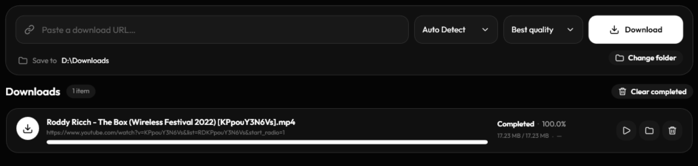
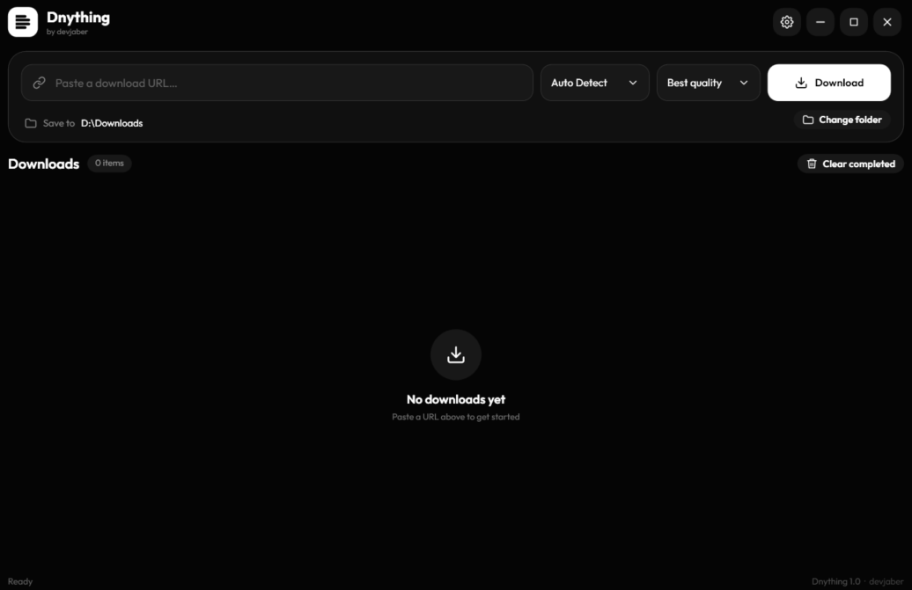
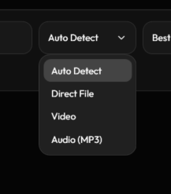
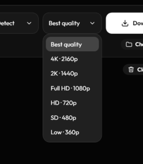

<div align="center">



# Dnything

### Download anything. Fast.

**One focused Windows downloader for files, videos, and audio.**  
Fast transfers. Smart media detection. Full control. No complicated setup.

[](https://github.com/devjaber/Dnything/releases)


**[Download for Windows](https://github.com/devjaber/Dnything/releases) · [Explore Features](#features) · [Supported Platforms](#supported-platforms) · [Get Started](#getting-started)**

</div>

---

<div align="center">
  
  <p><sub>A clean, black-and-white experience built around your downloads.</sub></p>
</div>

## Meet Dnything

**Dnything** is a lightweight, self-contained download manager for **Windows 10 and 11 (x64)**. Download direct files, save supported online videos and audio, manage multiple transfers, and choose the available quality—all from one streamlined desktop app.

It combines **segmented HTTP/HTTPS downloading** with the media extraction capabilities of **yt-dlp** and **FFmpeg**, without requiring you to install those tools separately.

> **Paste a link. Choose a format. Download.**

## Features

| | What you get |
|:--|:--|
| **Direct downloads** | Download files through HTTP and HTTPS, including ZIP, EXE, PDF, images, archives, and more. |
| **Segmented transfers** | Use multiple connections for faster direct downloads when the server supports range requests. |
| **Video & audio** | Download supported media using bundled `yt-dlp` and `FFmpeg`. |
| **Smart detection** | Automatically identify supported file and media URLs. |
| **Quality selection** | Choose the best available quality or a preferred resolution. |
| **Download controls** | Pause, resume, retry, and cancel supported transfers. |
| **Queue & history** | Keep track of current, completed, and previous downloads locally. |
| **Duplicate protection** | Avoid adding duplicate active downloads. |
| **Clipboard detection** | Detect a copied URL for quicker downloads. |
| **Flexible settings** | Set your save folder, per-file connections, parallel downloads, and speed limits. |
| **Live information** | See progress, speed, transferred bytes, file size, and status. |
| **Minimal interface** | Monochrome UI, Outfit typography, Lucide-style icons, and rounded controls. |

## The App in Action

### 01 — Open Dnything

Launch the application, paste a link, and select **Auto Detect**, **Direct File**, **Video**, or **Audio**.

<div align="center">
  
</div>

### 02 — Download Direct Files

Get installers, documents, archives, images, and other files from standard HTTP/HTTPS links. Adjust connection settings and manage transfers from the same window.

<div align="center">
  
</div>

### 03 — Choose Your Quality

For supported media, select a quality preset before downloading. Available formats depend on the source video or audio.

<div align="center">
  
</div>

## Supported Platforms

### Download from Popular Social Media, Video & Audio Platforms

Dnything uses **yt-dlp** to handle media URLs from many popular websites. Examples include:

| Category | Platforms |
|:--|:--|
| **Social media** | **YouTube**, **Instagram**, **TikTok**, **Facebook**, **X (Twitter)**, **Reddit**, **Pinterest**, **Tumblr**, **Bluesky**, **LinkedIn**, **VK**, **Likee** |
| **Video & streaming** | **Vimeo**, **Twitch**, **Dailymotion**, **Rumble**, **Bilibili**, **PeerTube** |
| **Music & audio** | **SoundCloud**, **Bandcamp**, **Mixcloud** |
| **Direct downloads** | Any accessible **HTTP/HTTPS file URL** supported by the source server |

**Popular content types:** YouTube videos and Shorts, TikTok videos, Instagram Reels, Facebook videos, X posts with media, online clips, and audio tracks—**when the source and its extractor support them**.

**More websites:** yt-dlp provides extractors for many additional services. See the [official yt-dlp supported-sites list](https://github.com/yt-dlp/yt-dlp/blob/master/supportedsites.md).

> **Compatibility note:** No downloader can guarantee every link from every social network. Platform changes, login requirements, geographic restrictions, DRM, unavailable formats, and source limitations may affect downloads. Listing a platform here does not mean every URL or content type is supported. Dnything does not bypass protected or private content.

## Quality Options

Choose from the formats offered by the source:

| Preset | Resolution |
|:--|:--|
| **Best Available** | Highest available quality |
| **4K / UHD** | 2160p |
| **2K / QHD** | 1440p |
| **Full HD** | 1080p |
| **HD** | 720p |
| **SD** | 480p |
| **Low** | 360p |

For audio-only downloads, output formats and quality depend on the available source streams and the app's media processing options.

## Download

### Windows — Standalone x64

**[Get Dnything.exe from GitHub Releases](https://github.com/devjaber/Dnything/releases)**

Dnything is distributed as a **single-file, self-contained Windows application**. When a build is published, download `Dnything.exe` from the Releases page and run it—no separate setup for .NET, yt-dlp, or FFmpeg is required.

> **Release availability:** The download is available once a release containing `Dnything.exe` has been published. Always use a release you trust.

## Getting Started

1. Open the [Releases page](https://github.com/devjaber/Dnything/releases) and get `Dnything.exe` when available.
2. Run the app on a compatible **Windows 10 or Windows 11 x64** computer.
3. Paste a direct file link or a supported media URL.
4. Select **Auto Detect**, **Direct File**, **Video**, or **Audio**.
5. If you're downloading media, select the desired **quality** when available.
6. Choose a **save folder**, then click **Download**.
7. Monitor progress or use the queue controls to manage your downloads.

## Standalone by Design

The Windows x64 build includes what it needs for downloads:

- **Self-contained .NET application** — no separate .NET Runtime installation.
- **Embedded yt-dlp** — no manual installation of the media downloader.
- **Embedded FFmpeg** — no manual installation of the media processing tools.
- **No separate background download service** — the app handles its own queue and history.

On the first media download, the required bundled runtime tools are extracted to:

```text
%LOCALAPPDATA%\Dnything\runtime-tools
```

## System Requirements

| Requirement | Details |
|:--|:--|
| **Operating system** | Windows 10 or Windows 11 |
| **Architecture** | 64-bit x64 |
| **Connection** | Internet access for online downloads |
| **Storage** | Enough free disk space and permission to write to the chosen folder |

The current build is **not** intended for 32-bit Windows, Windows on ARM, or macOS.

## Privacy & Local Data

- **No account required** to use the application.
- Download settings, queue information, and history are stored **locally** on your computer.
- Downloaded files go to your chosen save location.
- Dnything does not unlock private, restricted, or DRM-protected content.
- Online download requests still connect to the source websites and services you use.

## Troubleshooting

<details>
<summary><b>Windows SmartScreen shows a warning</b></summary>

The executable may be unsigned. Confirm that the download came from a trusted release, verify the file as appropriate, and follow your organization's security policy before running it.

</details>

<details>
<summary><b>A social media or video URL does not work</b></summary>

Confirm that the URL is valid and accessible. Try **Auto Detect**. Some websites change their media formats or require access that Dnything does not provide. Not every supported website or media format is guaranteed to work.

</details>

<details>
<summary><b>My download is slow</b></summary>

Check your internet connection, destination disk space, source server, speed limit, and connection settings. Segmented downloading only helps when the source server supports it.

</details>

<details>
<summary><b>My preferred resolution is missing</b></summary>

Dnything can only request qualities available from the source and supported by its media extractor. Try **Best Available** or another preset.

</details>

## Responsible Use

Download only content you own or are authorized to download. Respect applicable laws, copyright, and each source service's terms. Dnything is a general-purpose download manager, not a tool for bypassing access restrictions or DRM.

## Project & Credits

- **Product:** Dnything
- **Design identity:** Data Stream — four unequal lanes representing data flow, speed, and multiple download types.
- **Repository:** [github.com/devjaber/Dnything](https://github.com/devjaber/Dnything)
- **Media engine:** [yt-dlp](https://github.com/yt-dlp/yt-dlp)
- **Media processing:** [FFmpeg](https://ffmpeg.org/)

## License

A repository license has not yet been specified. Add a `LICENSE` file defining the project's terms before inviting reuse, modification, or redistribution.

---

<div align="center">

**Dnything — Download anything. Fast.**

Built for Windows. Designed to stay out of your way.

</div>
